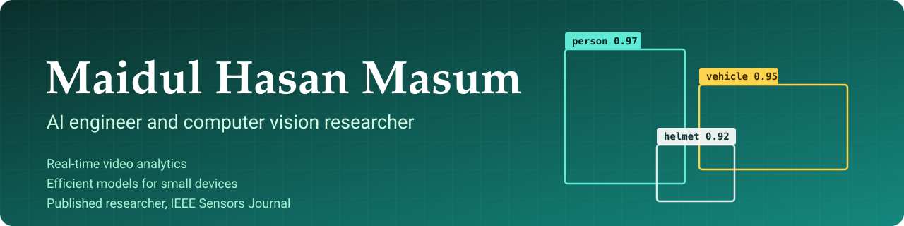

 

I build computer vision systems that run on live camera feeds, and I research how to make detection models small enough for devices with very little memory and power.

## At a glance

| | |
| --- | --- |
| **Industry** | AI Algorithm Engineer at Graymatics, Singapore, since September 2023. Production computer vision on 200+ live camera streams, with 80+ different analytics and 300+ deployments across cameras. |
| **Research** | Fully funded Graduate Research Assistant at Universiti Malaya (MSc by research, thesis submitted). Focus: efficient detection for edge devices. |
| **Publications** | First author of a review paper in **IEEE Sensors Journal** (2025). Four papers published, two accepted, three under review. |
| **Recognition** | Best Undergraduate Research Award, Dean's Award, First Class Honours (CGPA 3.70 out of 4.00). |
| **Teaching** | Computing teacher at Abedeen International School. Former English tutor at EF English Academy. |

## Research

| Project | What it does | Result |
| --- | --- | --- |
| [**LightYolo-SSO**](https://github.com/mh-masum6875/LightYolo-SSO) | An object detector for wireless sensor nodes. The architecture was found with Sperm Swarm Optimization instead of by shrinking an existing model. | **78%** fewer parameters than YOLOv7-tiny, a **2.9 MB** model, **99.57%** mAP@0.5 |
| [**Adaptive LightYolo-SSO**](https://github.com/mh-masum6875/Adaptive-LightYolo-SSO) | The same detector with early exits, so easy inputs skip most of the network. | **64.7%** less compute at **99.55%** accuracy, with 98.6% of samples leaving at the first exit |

## Applied computer vision

More than 80 analytics across seven areas, each with example code and an explanation of the approach. Start with the **[portfolio guide](https://github.com/mh-masum6875/enterprise-computer-vision-solutions)**.

| Area | What it covers | Repository |
| --- | --- | --- |
| Workplace safety | Protective gear checks, falls, loitering, danger zones | [workplace-safety-vision](https://github.com/mh-masum6875/workplace-safety-vision) |
| Traffic | Lane and direction counting, day and night adaptation | [traffic-flow-analytics](https://github.com/mh-masum6875/traffic-flow-analytics) |
| Maritime and subsea | Vessel identification, hull number OCR, reef surveys, smoke and fire | [maritime-subsea-vision](https://github.com/mh-masum6875/maritime-subsea-vision) |
| Retail | Self-checkout checks and theft behaviour | [retail-loss-prevention-vision](https://github.com/mh-masum6875/retail-loss-prevention-vision) |
| Food hygiene | Hairnets, handwashing, uncovered food | [food-hygiene-vision](https://github.com/mh-masum6875/food-hygiene-vision) |
| Healthcare | In-bed restlessness, bed exits, posture | [patient-monitoring-vision](https://github.com/mh-masum6875/patient-monitoring-vision) |
| Sanitation | Waste sorting and weight estimation, cleanliness | [waste-cleanliness-vision](https://github.com/mh-masum6875/waste-cleanliness-vision) |

## Selected publications

- **Toward Efficient and Accurate Anomaly Detection in Wireless Sensor Networks: A Review.** *IEEE Sensors Journal*, 2025. First author. [DOI](https://doi.org/10.1109/JSEN.2025.3618906)
- **Critical Review on Resource Scheduling in IaaS Clouds.** *The Journal of Engineering* (IET and Wiley), 2024. [DOI](https://doi.org/10.1049/tje2.12420)
- **Factors Influencing the Adoption of IoT for E-Learning in Higher Educational Institutes in Developing Countries.** *Frontiers in Psychology*, 2022. [DOI](https://doi.org/10.3389/fpsyg.2022.915596)
- **Edge AI-Driven Wireless Vision Sensor Networks for Collaborative Robotic Perception.** INTRAC 2025, Springer. Accepted, first author.

The full list is on [Google Scholar](https://scholar.google.com/citations?user=vjshqTUAAAAJ&hl=en), and the papers under review are on my [portfolio](https://mh-masum6875.github.io/#publications).

## Experience

| Role | Where | When |
| --- | --- | --- |
| AI Algorithm Engineer | Graymatics, Singapore | Sep 2023 to present |
| Graduate Research Assistant | Universiti Malaya | Oct 2024 to present |
| Research Assistant | Universiti Teknologi Malaysia | Aug 2020 to Sep 2023 |
| AI Research and Development Intern | Maybank | Sep 2022 to Feb 2023 |
| AI Development Intern | proceedit Trading (Expertel), remote | Jan to Aug 2022 |

## Other projects

- [**MetaTr@cker**](https://github.com/mh-masum6875/MetaTr-cker): a free, ad-free Android fitness tracker (Java, Firebase).
- [**Bluetooth Robot Controller**](https://github.com/mh-masum6875/BluetoothController): a Flutter app that drives an Arduino robot.
- [**Online School Management System**](https://github.com/mh-masum6875/Online-School-Management-System): school records, attendance and results (Java, Spring MVC, MySQL).

## Skills

**Computer vision and ML**

**Deployment**

**Languages**

## Get in touch

I'm open to computer vision and AI engineering roles, research collaborations and pilot projects. I'm especially interested in video analytics for ports and shipping.

Email me at [mhmasum6875@gmail.com](mailto:mhmasum6875@gmail.com), find me on [LinkedIn](https://www.linkedin.com/in/mhmasum6875), or read more at [mh-masum6875.github.io](https://mh-masum6875.github.io).
